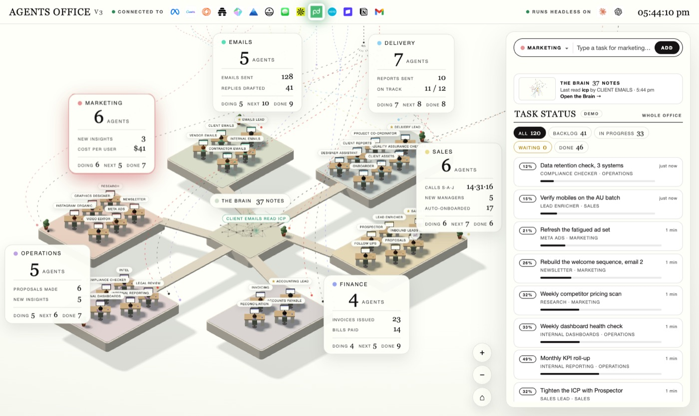

# Órbita



Um escritório isométrico 3D onde agentes de IA fazem trabalho real no teu próprio login do Claude.

**Criado por Chelton Mahoze.**

Seis salas, trinta e cinco agentes nas secretárias, uma barra de tarefas que encaminha o
que escreves para a pessoa certa, e um Cérebro no centro que é a tua própria pasta de notas.
Escreves uma tarefa, o escritório entrega-a a quem deve, essa pessoa lê as tuas notas, usa os
conectores que já tens no Claude Code, faz o trabalho e arquiva o resultado de volta nas notas.
Tudo corre na tua máquina.

## O que precisas

- macOS, Linux ou Windows (no Windows usa os comandos `npm` diretamente, o `./setup` é Bash)
- Node.js 20+ — https://nodejs.org
- git
- **uma chave de IA** — qualquer uma destas serve:
  - `GEMINI_API_KEY` do Google AI Studio (aistudio.google.com/apikey): **não instala nada**, fala
    direto com a API do Google (`gemini-flash-latest` por omissão);
  - **Claude Code** com sessão iniciada, ou uma `ANTHROPIC_API_KEY`.

## Instalação

```bash
git clone <este-repositório>
cd agents-office-main
npm ci
cp .env.example .env   # põe lá a GEMINI_API_KEY (o .env nunca vai para o git)
node build.mjs         # gera dist/command-centre-v2.html (o escritório num único ficheiro)
npm start              # → http://localhost:4520
```

Sem chave nenhuma o escritório abre e diz, em cada sítio, o que falta — não finge que trabalha.
Com a chave do AI Studio, os 35 agentes encaminham, escrevem e conversam de imediato. Para Chrome,
ficheiros e conectores MCP, precisa do Claude Code (uma API dá voz, não mãos): ver
[AI.md](AI.md).

Atalho: `./setup` faz as três coisas e arranca o escritório uma vez para testar.

## Os primeiros cinco minutos

1. Abre http://localhost:4520. O painel à direita diz **EM DIRETO · CLAUDE** quando o servidor
   está ligado. Abrir `dist/command-centre-v2.html` com duplo clique mostra o mesmo escritório
   sozinho, em modo de demonstração.
2. Na barra do topo do painel escolhe um departamento, escreve a tarefa em palavras simples e
   prime **Adicionar**. O Claude escolhe o agente e dá-lhe nome; a tarefa aparece na lista, o
   agente pega nela, trabalha, e o resultado cai na conversa desse agente e na tua pasta de notas.
3. Clica num agente para falares com ele. Responde no seu papel, ancorado nas tuas notas.
   Diz `revê: mais curto` e ele refaz a última entrega.
4. Prime **G**, ou clica no Cérebro, para ver as notas como grafo. Passa o rato numa nota para ver
   as ligações, clica para ler onde está e quem a leu ou escreveu.
5. A barra do topo mostra os conectores a que o teu Claude Code está ligado. Quando um agente usa
   um deles, o logótipo pulsa e o fio até esse departamento acende.
6. As primeiras entregas vão ser competentes e genéricas: os agentes conhecem o estúdio de exemplo
   e uma frase sobre o próprio trabalho. Aponta o Cérebro para as tuas notas e ensina-os a
   trabalhar contigo (abaixo). É aí que o escritório passa a ser teu.

## Conectores

A barra por baixo de **LIGADO A** é real: é a lista do `claude mcp list` nesta máquina, a mesma
que os agentes recebem como ferramentas. Gmail, Slack, Notion, Google Drive, Canva, o que tiveres
ligado em claude.ai ou adicionado com `claude mcp add`. Um servidor que precise de autenticação
aparece a cinzento com a razão ao passar o rato, e não é ligado a nenhuma sala até funcionar.
Nada ligado? A barra di-lo.

Os agentes podem chamar esses servidores enquanto trabalham, mais a pesquisa web. Nunca recebem
Bash, ferramentas de ficheiros nem sub-agentes. A regra permanente: lê à vontade; enviar,
publicar, pagar, apagar ou alterar só quando tu pedires.

### As integrações do próprio Órbita

Além do que estiver ligado no teu Claude Code, o escritório traz o seu próprio servidor MCP —
`orbita_integrations`, em `mcp-servers/orbita-integrations/` — com 15 ferramentas: pesquisa de
empresas no OpenStreetMap, CRM de leads, rascunhos com Gemini, email aprovado pelo Resend,
metadados e commit de um ficheiro no GitHub, link de WhatsApp, fila de conteúdo, publicação no
Instagram e deploy na Vercel. É arrancado e testado a sério no arranque (`initialize` + `tools/list`)
e entregue aos agentes por `--mcp-config`; o estado real está em `GET /api/mcp`.

Há um segundo servidor do projeto, `orbita_google`, com quatro ferramentas para os agentes
procurarem por sua conta: `google_places_search` (empresas reais — o mesmo motor da gaveta LEADS),
`google_web_search` (informação e contexto), `google_leads_saved` e `google_leads_save`. Sem chave,
a resposta diz qual variável falta — `GOOGLE_MAPS_API_KEY` e/ou `GOOGLE_API_KEY` + `GOOGLE_CSE_ID`
(ver [PESQUISA.md](PESQUISA.md)). Os dois são arrancados e testados no arranque; `GET /api/mcp`
mostra as 19 ferramentas.

As rotas HTTP equivalentes vivem em `/api/*` e exigem `Authorization: Bearer $ORBITA_API_TOKEN`
com 32+ caracteres. Guia completo, limites e o que **não** existe (Stripe, envio pela WhatsApp
Business API): [docs/INTEGRATIONS.md](docs/INTEGRATIONS.md). O segundo servidor local,
`mcp-servers/view-image-mcp/`, dá olhos aos agentes — abre qualquer URL pública como imagem e
precisa de `npm install` dentro dessa pasta.

## Os 35 agentes

| Sala | Quem lá está |
|---|---|
| **Comando** | ORBITA Director · Chefe de Gabinete · Analista de Resultados · Painel Central · Permissões e Conformidade |
| **Prospeção** | Lead Hunter · Enriquecador · Qualificador · Inteligência de Mercado · Análise Competitiva · Auditor de Websites |
| **Vendas** | Sales Closer · Propostas · Seguimentos · Receção de Clientes · Contratos · Comunicação com Clientes |
| **Design Lab** | Creative Architect · UI e Design System · Direção de Arte · Pesquisa UX |
| **Engenharia** | Systems Engineer · Gestor de Projetos · QA e Testes · Frontend · Backend e Integrações · Deploys e Infra · Documentação Técnica |
| **Media** | Growth Publisher · Conteúdo e Newsletter · Anúncios Meta · Redes Sociais · Vídeo · Calendário Editorial · Analytics de Conteúdo |

Cada agente tem: um papel, uma descrição do que faz, as ferramentas que pode usar, as
competências que segue e um briefing com as tuas instruções permanentes. Tudo isso se edita em
`office.agents.json` (ou em `office.agents.local.json`, que o git ignora).

## Rotinas: o escritório no seu próprio relógio

Uma rotina é uma tarefa com uma hora dentro, dita em português simples:

```
todos os dias úteis às 8h, triar a caixa de entrada e dizer-me o que precisa de mim
todas as segundas e quintas ao meio-dia, rever as propostas abertas
de hora a hora, das 9h às 17h, ver as campanhas de anúncios
a cada 30 minutos, verificar a fila de entrada
todas as sextas às 17h30, fechar a semana e escrever o resumo
```

O servidor cumpre a rotina ao minuto, mesmo com a página fechada. Se a rotina puder enviar,
publicar ou pagar algo, o resultado **espera pelo teu OK** antes de sair. As rotinas vivem em
`brain/Órbita/routines.json` e podem ser escritas à mão.

## O calendário (P)

Tudo no dia a que pertence: tarefas concluídas, o trabalho de hoje, tarefas agendadas e todas as
rotinas projetadas para a frente. Clica num dia para agendar uma tarefa, ou liga **REPETIR** para
começar uma rotina nessa data. Uma barra lateral lista as rotinas; clicar numa mostra só os dias
dela. Mês e semana, com modo escuro.

## As equipas: o líder divide, as secretárias trabalham

Prime **EQUIPA** ou diz «em equipa» na frase. O líder do departamento reparte o trabalho pelas
secretárias, todas trabalham ao mesmo tempo, deixam notas umas às outras e o líder escreve a
versão final. O número máximo de secretárias configura-se em `office.config.json` (`teams.max`).

## Qual modelo e quanto do teu plano

Sonnet, Opus ou Fable — por tarefa, por rotina, por agente ou para o escritório inteiro, com um
menu de esforço (Baixo a Máximo). A barra do topo mostra a sessão e a semana do teu plano quando o
Claude Code as expõe; sem login, mostra a contagem do próprio escritório.

## Pesquisa real: leads da Google

O botão **◈ LEADS**, na barra do topo, procura empresas **verdadeiras** na Google Places API (New):
nome, morada, telefone, site, avaliação e link do mapa, com uma nota de oportunidade explicada
(sem site pesa muito). Escreve «clínicas dentárias» e «Lisboa», prime PROCURAR — o que aparece fica
guardado em `data/leads.json`, sem duplicados. **→ TAREFA** transforma os melhores numa tarefa para
o Lead Hunter.

A **Prospeção** e as **Vendas** leem os oito melhores leads por contactar no início de cada tarefa e
escrevem com nomes e cidades reais — sem inventar contactos. Enviar continua a exigir o teu OK.

Precisa de uma chave: `GOOGLE_MAPS_API_KEY` (leads) e, se quiseres pesquisa web com o Programmable
Search, `GOOGLE_API_KEY` + `GOOGLE_CSE_ID`. Sem chave o escritório diz exatamente o que falta — não
inventa resultados. Guia completo, quotas e cuidados em **[PESQUISA.md](PESQUISA.md)**.

## Hoje: um ecrã, três perguntas

Abres o escritório e vês **Hoje**: o que precisa da tua decisão, o que aconteceu enquanto
dormias e o que vai acontecer. Os agentes não são uma lista — são um anel discreto na barra, que
pulsa quando há trabalho a acontecer.

A decisão é um **gesto**: desliza para a direita para aprovar, para a esquerda para rejeitar, e
um toque longo abre o **porquê** («escolhi este tom porque o negócio tem 4,8★ e poucas
avaliações»). Cada gesto tem um botão equivalente e uma tecla (`←` rejeitar, `→` aprovar) — quem
usa teclado ou leitor de ecrã não fica de fora. O cartão sai no instante em que decides e, se o
servidor recusar, volta com a razão escrita.

No topo está o **PARAR TUDO**: um toque e não sai mais nenhum envio, seja qual for o caminho.

## Operação: guardado, aprovado, com rasto

Os leads, as mensagens, a fila e o registo do que aconteceu vivem numa base de dados SQLite
(`data/orbita.db`, sem dependências — `node:sqlite`). O botão **◉ OPERAÇÃO**, na barra, abre a
gaveta: os leads por nota com as **razões** dela, as mensagens à espera do teu OK, a fila de
trabalho e a auditoria.

Três regras que a camada faz cumprir: **nada sai sem aprovação** (uma mensagem nasce rascunho e
só o dono a aprova), **o opt-out manda** (quem pede para parar fica bloqueado em definitivo) e
**o funil não salta passos** (de «novo» para «cliente» é recusado). O envio de email exige
consentimento registado e `RESEND_API_KEY`; o WhatsApp é um link revisto e enviado à mão — o
Órbita não finge que enviou. O que falha fica na fila e volta a tentar, com espera crescente.

A pesquisa da Google passa a gravar também nesta base de dados, já pontuada e sem duplicados.
Detalhe completo — tabelas, rotas `/api/ops`, aquecimento do número, custos e **o que ainda não
está** (Stripe, WhatsApp Business real, Postgres) — em **[OPS.md](OPS.md)**.

## Integrar outra IA (Codex, Antigravity, qualquer API)

O escritório não está preso ao Claude Code. O botão **IA**, ao lado de EQUIPA no painel de tarefas,
mostra o motor que está a responder; clica e vês todos os que existem nesta máquina — **Claude Code**,
**Codex**, **Gemini**, uma **CLI personalizada**, e as APIs **Claude, OpenAI, OpenRouter, Groq,
Mistral, DeepSeek, xAI, Gemini, Ollama e LM Studio**, mais **qualquer endpoint compatível com OpenAI**.
Cada linha diz se está ligado ou o que lhe falta («`codex` não está no PATH — instala com
`npm i -g @openai/codex`»), tem **TESTAR** (um turno curto a sério, com o texto e os milissegundos)
e **USAR** (troca a quente, sem reiniciar).

A diferença é honesta: o **Claude Code** é o único que dá mãos ao agente (ferramentas MCP e Chrome);
os outros devolvem texto. As chaves vivem no ambiente, nunca em ficheiros. Nada é instalado por ti.
O detalhe — tabela de motores, `ai.*` no `office.config.json`, ordem de escolha (`AO_AI` →
`data/ai.json` → `ai.provider` → `ai.fallback`) e as rotas `/api/ai` — está em **[AI.md](AI.md)**.

## Ensinar os agentes

- **Entrevista**: abre a conversa de um líder e diz `configurar`. Ele faz-te cinco perguntas e
  escreve os briefings da equipa e uma competência para o trabalho que descreveste.
- **Correções**: quando devolves uma entrega com uma nota (`revê: …`), a lição fica registada em
  `brain/Órbita/feedback/<agente>.md`. Regras permanentes entram em todas as tarefas seguintes.

## Competências (skills)

Cada pasta em `skills/` é uma competência: um `SKILL.md` com cabeçalho (`name`, `description` e,
opcionalmente, `departments`/`agents`) e o procedimento em markdown. As tuas vivem em
`brain/Órbita/skills/<nome>/SKILL.md` e ganham em caso de nome igual.

## Configuração

`office.config.json`:

```json
{
  "name": "Órbita Studio",
  "brain": "./brain",
  "port": 4520,
  "model": "sonnet",
  "mcp": { "allow": [], "deny": [], "departments": {} },
  "tools": { "web": true, "browser": true },
  "teams": { "enabled": true, "max": 4 },
  "ai": { "provider": "auto", "fallback": ["claude-cli", "codex-cli", "gemini-cli", "anthropic", "openai"] }
}
```

Variáveis de ambiente: `AO_MODEL` (modelo da casa), `AO_PORT`, `AO_AI` (motor de IA: `claude-cli`,
`codex-cli`, `gemini-cli`, `anthropic`, `openai`, `ollama`, …), `AO_AI_MODEL` (modelo desse motor) e
as chaves de cada API (`ANTHROPIC_API_KEY`, `OPENAI_API_KEY`, `OPENROUTER_API_KEY`, `GROQ_API_KEY`,
`MISTRAL_API_KEY`, `DEEPSEEK_API_KEY`, `XAI_API_KEY`, `GEMINI_API_KEY`, `AO_AI_KEY`) e as da pesquisa
(`GOOGLE_MAPS_API_KEY`, `GOOGLE_API_KEY`, `GOOGLE_CSE_ID`). Alterações locais vão para
`office.config.local.json` (ignorado pelo git). Ver [AI.md](AI.md) e [PESQUISA.md](PESQUISA.md).

As horas em todo o escritório são de **24 horas** (`00:00`–`23:59`), nunca AM/PM — o campo de hora
mostra as 24 horas do dia e a hora que o browser está a usar não muda isso.

## API

| Método | Rota | O que faz |
|---|---|---|
| GET | `/api/health` | versão, empresa, modelo, departamentos, agentes |
| GET | `/api/agents` | o elenco tal como está em disco |
| GET | `/api/brain` | o grafo de notas |
| GET/POST | `/api/tasks` | listar / criar tarefas |
| POST | `/api/tasks/:id/run` · `/revise` · `/approve` · `/reject` | correr, rever, aprovar, rejeitar |
| GET/POST | `/api/routines` | ler / criar rotinas |
| POST | `/api/chat` | falar com um agente |
| GET | `/api/ai` | os motores de IA: o que está ligado, o que falta e porquê |
| POST | `/api/ai/test` | um turno curto a um motor (`{"provider":"codex-cli"}`) |
| POST | `/api/ai/switch` | trocar de motor a quente (`{"provider":"anthropic"}`) |
| GET | `/api/google` | estado da pesquisa (Places + Programmable Search) |
| POST | `/api/google/search` | procurar empresas ou web (`{"kind":"places","what":"ginásios","where":"Porto"}`) |
| GET | `/api/leads` | a lista de leads guardada, por nota |
| POST | `/api/leads/status` | mudar o estado de um lead |
| GET | `/api/ops/summary` | funil, conversão, custos e estado da fila |
| GET/POST | `/api/ops/leads` | os leads guardados / importar (um ou `{ leads: [...] }`) |
| PATCH | `/api/ops/leads/:id` | andar um passo no funil (`{ "status": "contactado" }`) |
| POST | `/api/ops/consent/opt-out` | bloquear um email/telefone para sempre |
| GET/POST | `/api/ops/messages` | mensagens / criar rascunho |
| POST | `/api/ops/messages/:id/approve` · `/reject` · `/send` · `/confirm` | a decisão e o envio |
| GET | `/api/ops/queue` · `/api/ops/events` · `/api/ops/usage` | fila, auditoria, consumo |
| GET | `/api/ops/today` | o ecrã Hoje: decisões, acontecimentos, o que vem a seguir |
| POST | `/api/ops/stop` | interruptor de emergência (`{ "stop": true }`) |
| GET | `/api/ops/outbox` | fila de saída: alugueres, tentativas, revisões |
| GET | `/api/ops/events/verify` | verifica a cadeia de hashes do registo |

## Verificação

```bash
npm run check         # 59 verificações locais (build, elenco, competências, rotinas, operação, Hoje, servidor)
npm run test:ops      # 17 testes da operação: base de dados em memória, nenhum serviço externo
npm run test:integrations  # 18 testes das integrações e da pesquisa Google
npm run check:live    # uma tarefa e uma conversa a sério, pelo Claude
```

A única verificação que falha numa máquina sem Chrome instalado é a do navegador
(`npx playwright install chrome`).

## Estrutura

```
serve.mjs            servidor local + API
providers.mjs        os motores de IA: CLIs e APIs (ver AI.md)
google.mjs           a pesquisa real: Places (leads) e Programmable Search (ver PESQUISA.md)
src/                 a página: cena 3D, painel, calendário, cérebro
brain/               as tuas notas (o Cérebro)
skills/              competências incluídas
office.agents.json   o elenco
office.config.json   nome, porta, modelo, equipas
data/                tarefas e estado (ignorado pelo git)
dist/                o escritório compilado num único HTML
```

## Licença e créditos

- **Órbita** — criado por **Chelton Mahoze**.
- Derivado de *Agents Office* (Sahni.ai), distribuído sob **PolyForm Noncommercial 1.0.0** com
  termos adicionais. Vê [LICENSE](LICENSE): uso pessoal e interno, sem revenda nem rebranding
  comercial do produto original.
- O texto original em inglês deste README está em [README.en.md](README.en.md).
