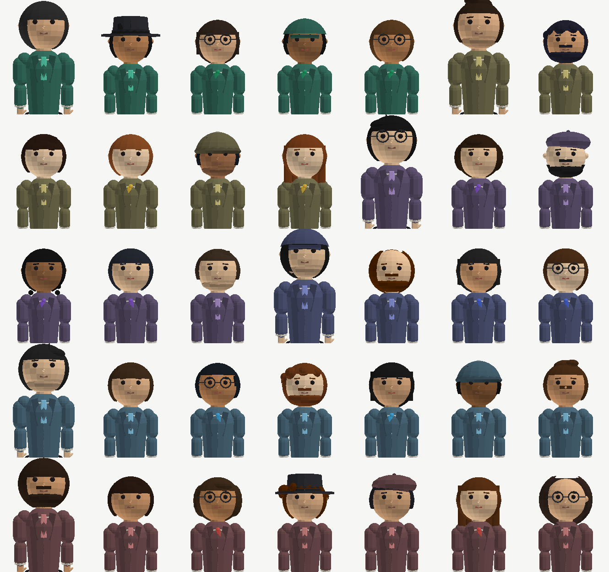
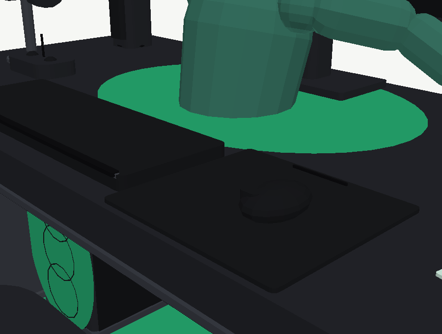

# As pessoas — avatares, mãos e teclados (1.10.0)

*Pedido 28: «melhorar as interações do braço de avatar mexendo realmente o mouse e digitando nos
teclados e melhore o avatar, uma vibe mais pessoa real com roupa formal, mas cada sala mantém a
coloração da roupa ficando mais realista, cabelo diferente para cada agente (35), alguns com
chapéu, alguns serão mulheres». 27 out 2026.*

## O problema não era a animação

Antes desta versão, o avatar «trabalhava» com o ombro a oscilar seis centímetros. As mãos nunca
tocavam em nada, e não era por falta de animação: era porque **ninguém sabia onde estava o
teclado**. O `builders.js` desenhava-o a `z = 0.42`, o avatar esticava o braço para um sítio
calculado à mão noutro ficheiro, e os dois números nunca foram verificados um contra o outro.

A cura foi um contrato.

## `src/deskmap.js` — onde estão as coisas

Um ficheiro **puro** (sem `three`, sem DOM), por isso testável em `node --test`:

| | |
|---|---|
| `SEAT` | `{x: 0, y: 0.55, z: 1.7}` — onde o avatar sentado tem a raiz |
| `KEYBOARD` | `{x: -0.22, y: 2.398, z: 0.86, w: 1.68, d: 0.52, capH: 0.024}` |
| `KEY_GRID` | 320×110 px: 14 colunas × 4 filas + barra de espaço = **57 teclas** |
| `MOUSE_PAD` | `{x: 1.16, y: 2.339, z: 0.84, w: 1.02, d: 0.86}` |
| `MOUSE` | `{r: 0.115, sy: 0.58, sz: 1.42}`, topo a `2.462` |
| `MOUSE_TRAVEL` | `{x: 0.20, z: 0.28}` — o quanto a mão pode andar no tapete |

E as funções que respondem a perguntas, em vez de números espalhados:

- `keyCells()` — as 57 células (centro, largura, profundidade), **as mesmas** que a textura do
  teclado desenha e que as teclas instanciadas ocupam;
- `nearestKey(x, z)` — que tecla é esta;
- `toAvatarLocal(p)` — a conta do posto rodado 180° (o avatar olha para `-z` do posto);
- `mouseAt(t, phase)` — o passeio do rato dentro do tapete (nunca sai dele);
- `typingHand(t, phase, side)` / `clickBeat(t)` — onde está cada mão e quando prime;
- `contact(t, phase, mode)` — **um** objecto com o que a mão toca: `{keys, mouse, second}`.

Quem desenha (`builders.js`), quem posa (`avatar.js`) e quem anima (`main.js`) leem daqui. Se
alguém mudar o teclado de sítio, a mão vai atrás.

## O braço

Cadeia `ombro → cotovelo → punho → mão`, com IK de dois ossos (`solveArm`): dados o ombro e a ponta
que se quer atingir, resolve-se o cotovelo com a lei dos cosenos e escolhe-se o lado com um vector
`pole` (o lado de fora do corpo). O punho desloca-se para trás pela distância `HAND_TIP`, para que
seja **a ponta do dedo** — e não o pulso — a chegar à tecla.

Duas coisas que só um teste apanha:

1. **O IK resolvia para um braço que não existia.** `A + B` era `0.60 + 0.55` e a geometria media
   `0.54 + 0.50`; a mão parava 8 cm antes do alvo, sempre. Agora há uma constante (`ARM_A`, `ARM_B`)
   usada nos dois sítios.
2. **A mão do rato herdava a orientação do teclado.** O pulso era calculado com a direcção do rato
   e a mão rodava com a do teclado: 15 cm de erro. Hoje a direcção viaja dentro do alvo.

Com as mãos em contacto, a respiração do grupo pára (senão os dedos deslizavam pela tecla).

## O que o posto faz

- **A digitar** — a mão segue uma tecla, a tecla **afunda 8 mm** (as 57 são **uma** malha
  instanciada por posto) e volta.
- **No rato** — o rato é uma malha própria (`mouseG`) e desliza no tapete. Vai **onde a mão está**,
  não ao contrário: quem manda é o avatar.
- **A troca** — a cada ~5 s uma mão vai ao rato. Não salta: atravessa a mesa em ~0.3 s e não prime
  teclas a caminho (`handOff`).

## As 35 pessoas

`src/looks.js` é uma **tabela escrita à mão** — não é sorteio, e o teste compara assinaturas:

- 15 estilos de cabelo × 4 variantes (risca, comprimento, volume) = 35 penteados distintos;
- 14 mulheres, 21 homens; 8 chapéus (fedora, boné, gorro, barrete); 11 barbas; 7 óculos.

**O fato é a cor da sala.** O casaco nasce do `chip` da sala (mesmo matiz, mais fundo e levemente
dessaturado), as calças são grafite misturada com ele, e a **gravata acende com o vidro**
(`dept.glass`). Assim a sala continua a ler-se pela cor, mas veste-se em vez de se pintar.

Corte formal: casaco com lapelas, camisa, gravata (homens), lenço ou blazer ou vestido (mulheres —
`variant % 2`), cinto, punhos, sapatos. Cara: olhos, sobrolhos, nariz, lábios, brincos, óculos com
aro e ponte, barba por tipo (apara, cheia, bigode).

## O custo

| | |
|---|---|
| malhas por avatar (sentado) | ~10 — a cabeça inteira é **uma** malha, o tronco outra, cada mão outra |
| teclas | **uma** `InstancedMesh` de 57 por secretária |
| build | `dist/command-centre-v2.html` 1 404 kB, `mesa.html` 86 kB |

## O que está provado (e como)

`office.test.mjs` — 11 testes novos (49 no total):

- 35 aparências distintas, tabela válida, e a tabela **apanha** uma linha em falta;
- o fato de cada agente tem o matiz da sala (≤ 14°) e é mais fundo que o `chip`;
- as 57 teclas cabem no teclado e `nearestKey` devolve cada uma para si própria;
- o rato nunca sai do tapete e não está parado (mas anda pouco, como uma mão);
- **a ponta do dedo cai a menos de 4 mm da tecla e do rato**, para os 35, nos dois modos, com o
  braço a chegar (sem esticar) e a mão do lado certo do corpo;
- a pressão é sempre 0–1; nenhuma pose dá `NaN`; nenhum avatar passa de 12 malhas;
- a secretária põe a tecla na célula e o rato entre o tapete e o cimo.

`scene.smoke.mjs` — no bundle construído: 35 looks com assinatura única, ≥ 8 mulheres, ≥ 5 chapéus,
seis cores de fato (uma por sala), as 57 teclas em cada posto e o rato como malha própria.

## Limitações, ditas

- **Não há capturas WebGL neste ambiente** (o Chromium do Playwright não está no sandbox). As imagens desta página são do **rasterizador de inspecção** (`tools/sheet35.mjs`,
  `tools/station.mjs`) (`tools/raster.mjs`, z-buffer próprio,
  `three` em node), que lê a geometria real — mas com sombreado plano e **sem** materiais, LED,
  bloom nem tone mapping. A cena no browser é mais escura e mais luminosa nas arestas.
- **Os dedos são uma malha por mão.** O toque lê-se na tecla a afundar e no pulso a descer; não há
  movimento por dedo (35 avatares × 10 dedos seriam 350 malhas a animar por frame).
- A **respiração** pára em quem está em contacto (é a troca que se fez para os dedos não deslizarem).
- O rato anda ±0.20 × ±0.28 no tapete: é uma mão a trabalhar, não um cursor de videojogo.
