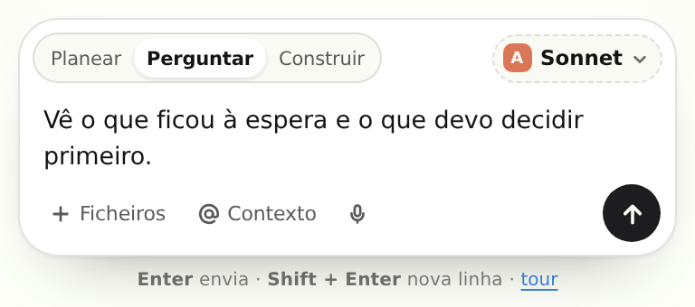
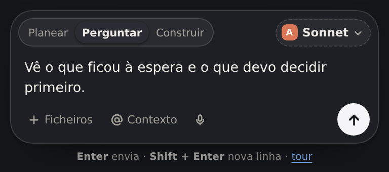
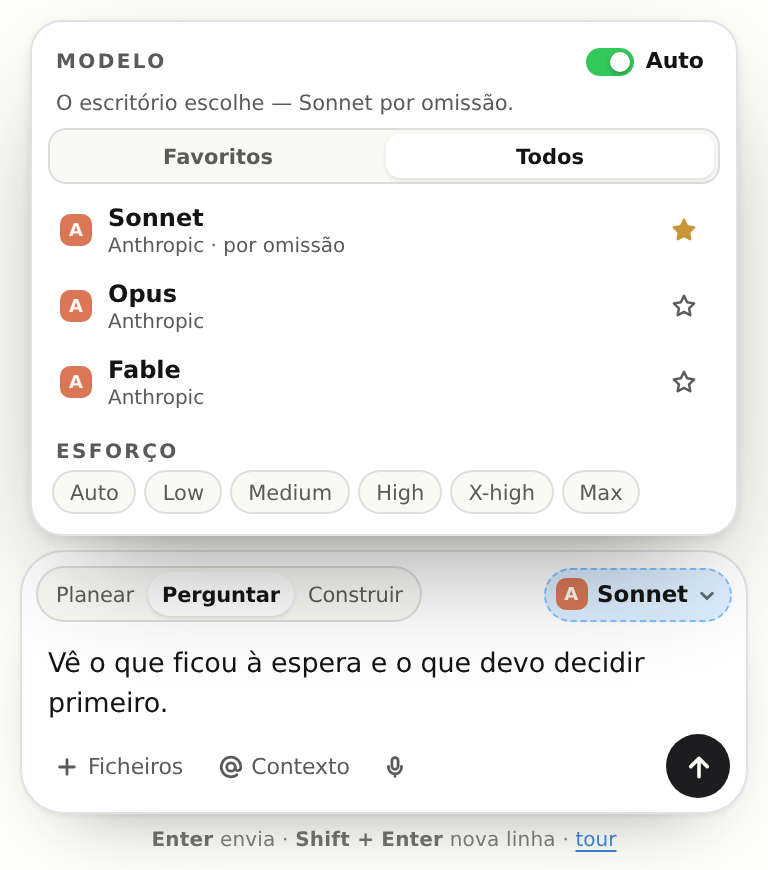

# O conversador

*A conversa de um posto — o cartão onde se escreve ao agente. 27 out 2026 (1.9.9).*

Até aqui, escrever a um agente era uma caixa de uma linha com um botão. O dono mandou o desenho de
um compositor completo (React, `ai-prompt-composer-with-model-selector.tsx`) e pediu que
**substituísse** o que existia. É este o resultado.





---

## O que substituiu o quê

| Antes (1.9.8) | Agora (1.9.9) |
| --- | --- |
| `<textarea id="mIn">` + `<button id="mSend">` numa cápsula | o mesmo `#mIn` e o mesmo `#mSend`, dentro de um cartão com barra, modo, modelo, anexos, contexto e ditar |
| só texto | texto, **modo** (Planear · Perguntar · Construir), **modelo e esforço**, **ficheiros**, **contexto** e **voz** |
| sem estado | as preferências (modo, modelo, esforço, favoritos) ficam no `localStorage` (`orbita_composer_v1`) |

Os ids que os testes e o resto da página conhecem (`#mIn`, `#mSend`, `#mChips`, `#mMsgs`) **não
mudaram** — a substituição é de desenho e de capacidade, não de contrato.

## Onde vive

| Peça | Ficheiro |
| --- | --- |
| marcação do cartão, do aviso e do modal | `src/shell.html` (`#mChat .m-foot`, `#mc`, `#mcPro`, `#mcModal`) |
| desenho e comportamento do compositor | `src/composer.js` (novo) |
| envio, mensagens e o que se segue | `src/main.js` (`sendChat`, `buildFromChat`) |
| o que o motor recebe | `serve.mjs` (`POST /api/chat`, `chat()`) |

## As peças, e o que cada uma faz a sério

- **Modos.** `Planear` pede um plano ao motor **sem ferramentas** (o servidor desliga-as e diz-lhe
  para não executar nada); `Perguntar` é a conversa de sempre, com as notas da empresa; `Construir`
  **cria a tarefa na base de dados** (`POST /api/tasks` com `run: true`) — nasce em `doing` e entra na fila do servidor no mesmo instante; o resultado cai na conversa e na nota do Cérebro. Nenhum dos três
  altera estado sem trabalho: Planear e Perguntar não escrevem nada, Construir escreve na tabela
  das tarefas — e diz o id.
- **Modelo e esforço.** A lista vem de `GET /api/health` — `models: ["sonnet","opus","fable"]`,
  `efforts: ["low","medium","high","xhigh","max"]` —, nunca de uma lista de exemplo. `Auto` (por
  omissão) deixa a precedência da casa decidir; escolher um modelo ou um esforço envia-o **para
  aquela mensagem** (`model`, `effort`), dentro da mesma precedência (tarefa → rotina → agente →
  escritório). O menu tem separadores **Favoritos / Todos**; a estrela guarda o favorito.
- **+ Ficheiros.** Só texto (`.txt .md .csv .json .log .yml .yaml .js .ts .css .html .sql .py …`),
  até 5 ficheiros, 40 000 caracteres cada, 60 000 no total. O conteúdo vai no corpo do pedido e é
  lido pelo agente **só naquela mensagem** — não é guardado em lado nenhum. Imagens e PDF são
  recusados com a razão, não ignorados em silêncio.
- **@ Contexto.** `@Cérebro` (as 35 notas da empresa) e `@Documentos` (os markdown de `docs/`, com
  título e primeiras linhas) existem; `@Terminal` **não** existe e a linha está desactivada a dizer
  porquê. Os números do menu vêm do servidor (`context.notes`, `context.docs`).
- **Ditar.** Usa a `SpeechRecognition` do browser quando ela existe (Chrome, Edge, Safari). No
  Firefox o botão fica desactivado com a razão escrita — não há simulação de voz.
- **A seta.** Só acorda quando há texto; a enviar, fica em espera; se o envio falhar, **o texto não
  se perde** e a razão aparece num aviso.
- **O aviso do motor** (o lugar do `Upgrade to Pro` do desenho original). O Órbita não vende
  planos, por isso não há preço para mostrar. No mesmo sítio aparece o que é verdade: quando o
  servidor diz que **não há motor de IA ligado**, o compositor di-lo, e o botão abre o estado real
  (motor, modelo por omissão, esforço, notas, documentos, limites). Com motor ligado, o aviso
  desaparece.
- **Tour.** Quatro passos que explicam modos, modelo, anexos/contexto e a seta. Fica dispensado
  depois de visto (`localStorage`); volta pelo «tour» na linha de ajuda.
- **Avisos (toasts).** Anexo recusado, ficheiro gravado, favorito, tarefa criada, erro de envio —
  com `role="status"` e `aria-live="polite"`.

## O que correu, por baixo da resposta

Cada resposta traz uma linha pequena: **modelo · esforço · modo · anexos · contexto**. Não é o que
se pediu — é o que o servidor diz que usou. Exemplo real (motor de teste local, ver «Provas»):

```
stub: recebi 6111 caracteres de sistema e 54 de pedido.
plano=false ficheiros=true documentos=true cerebro=true
```

e, por baixo, `Sonnet · esforço auto · 1 ficheiro · @Cérebro · @Documentos`.

## Porque não entrou React, Tailwind nem shadcn

O componente que o dono mandou é React + TypeScript e pressupõe `components.json`, Tailwind e um
passo de build para as classes utilitárias. O Órbita é **um único ficheiro HTML** que abre offline
sem CDN (`dist/command-centre-v2.html`), construído por `build.mjs` com esbuild a partir de módulos
JS simples. Trazer React + Tailwind para dentro desse bundle:

1. tirava o bundle de «um ficheiro que abre sozinho» para «um runtime e um CSS gerado»;
2. obrigava a um `tsconfig`, um `tailwind.config` e um `components.json` só para um componente;
3. punha ~140 kB de runtime entre o dono e uma caixa de texto.

Por isso o **desenho e o comportamento foram portados** para `src/composer.js` (≈600 linhas, sem
dependências), com os mesmos elementos e a mesma calma. Se um dia o projecto passar a React, o
caminho é: `esbuild` com `loader: { '.tsx': 'tsx' }`, `jsx: 'automatic'`, Tailwind CLI no build, e
o componente entra como está — mas deixa de haver um ficheiro só.

## Limitações, declaradas

- **O esforço é real nos motores CLI** (Claude Code, Codex), que recebem o nível na linha de
  comandos. Nos motores de **API compatível com OpenAI** o campo não existe no protocolo: o modelo
  é enviado, o esforço não. O menu diz isso quando o motor é desse tipo.
- **Os três nomes da casa podem ser o mesmo modelo** num fornecedor de API que não declare um
  modelo por nome (`ai.providers.<id>.models`). Nesse caso escolher Opus não muda o modelo que
  responde — e é o fornecedor que o decide, não a página.
- **Os anexos são texto.** PDF, DOCX e imagens não são extraídos. 60 kB é o tecto por mensagem.
- **`@Documentos` lê o título e as primeiras linhas** de cada markdown (até 6 000 caracteres no
  total), não os ficheiros inteiros.
- **O ditado depende do browser.** Sem `SpeechRecognition`, o botão está desactivado — não há
  gravação de áudio nem transcrição do lado do servidor.
- **`Construir` precisa do servidor.** Sem servidor (página aberta de um ficheiro), o modo recusa
  em vez de criar uma tarefa só no ecrã.
- **A conversa precisa de motor.** Sem `claude`, `codex`, `gemini` ou uma API configurada, a
  resposta é a razão da falha — nunca uma resposta inventada.

## Provas

```bash
npm run build          # 1380 KB, um ficheiro
npm run test:office    # 38/38 (7 novos: modos, anexos, contexto, corpo do pedido, meta, preferências)
npm run test:scene     # ✓ — inclui 15 asserções novas sobre o compositor no bundle
npm run test:a11y      # 21/21
npm run test:ops       # 71/71
npm run test:integrations   # 18/18
npm run check          # 94/95 (só «smoke: browser», que precisa de Chrome)
```

O `test:scene` corre o bundle real num DOM com WebGL falso: 24 asserções novas — os três modos, o menu do modelo
(abre e fecha com `aria-expanded`), o seletor de ficheiros, o menu de contexto com o terminal
desactivado e a razão escrita, o aviso do motor visível quando o servidor não responde, e o
`#mcModal` **fora** do `#rail` (a gaveta tem `overflow:hidden` e um `transform`; um `fixed` lá
dentro ficava cortado).

Também foi provado contra um **motor de teste local** (um servidor OpenAI-compatible de 40 linhas):
com `mode: "plan"` o sistema recebeu a regra de planear e `tools: false`; com `files` o conteúdo do
`brief.md` chegou ao motor; com `context: ["brain","docs"]` chegaram as notas escolhidas e
`docs/CENA.md`; e a resposta devolveu `model`, `modelFrom`, `effort`, `effortName`, `mode`,
`context` — que é exactamente o que a linha por baixo da resposta mostra.

## A caixa de tarefas, ao lado (1.10.1)

O conversador tem um irmão: o compositor da direita (`#tpanel .tp-cmd`), onde se escreve a tarefa
de um departamento. Em 27 out 2026 o dono olhou para ele e disse *«o chat deve ter um design bonito
nesta área»*. Tinha razão: a segunda linha eram **seis pastilhas de 8,5 px** — modelo, esforço,
REPETIR, EQUIPA, SEM IA, ADICIONAR — todas do mesmo tamanho e da mesma cor. Nada dizia o que era
uma escolha e o que era um interruptor, e o esforço estava em inglês (`LOW · MEDIUM · HIGH · X-HIGH
· MAX`) dentro de uma casa que fala português.

| Antes | Agora |
|---|---|
| 6 pastilhas iguais, 8,5 px | **2 campos com rótulo** (`Modelo`, `Esforço`), o valor em 12,5 px |
| — | uma **marca verde** no rótulo quando a escolha é tua e não a do escritório |
| REPETIR/EQUIPA/IA soltos | um **grupo segmentado** (uma moldura, divisórias de 1 px, o activo em tinta) |
| — | uma **nota** que diz o que a tarefa usa por omissão (`padrão: Sonnet · Automático`) |
| ADICIONAR igual às outras | a **única coisa sólida** da caixa, com a tecla `↵` |

Porquê esta ordem: o que se **escolhe** (modelo, esforço) fica em cima, junto do texto; o que se
**liga** (repetir, equipa, motor) fica em baixo, num grupo só; e a **acção** fica à direita, sozinha.
O esforço passou a ler-se `Automático · Baixo · Médio · Alto · Muito alto · Máximo` — as mesmas
chaves (`low … max`) no pedido para o servidor, só o rótulo mudou.

O que se prova automaticamente: `test:scene` verifica a estrutura no bundle (dois campos com rótulo,
três botões no grupo, `aria-pressed` nos interruptores, a nota com `padrão:`) e que as opções estão
em português; `test:office` fixa os rótulos (`Máximo`, `Muito alto`, `Baixo`).
